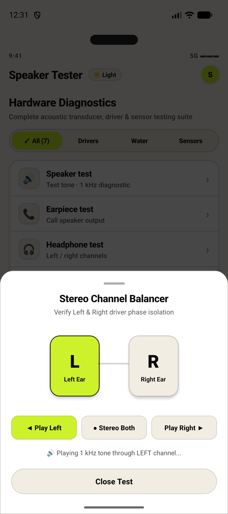
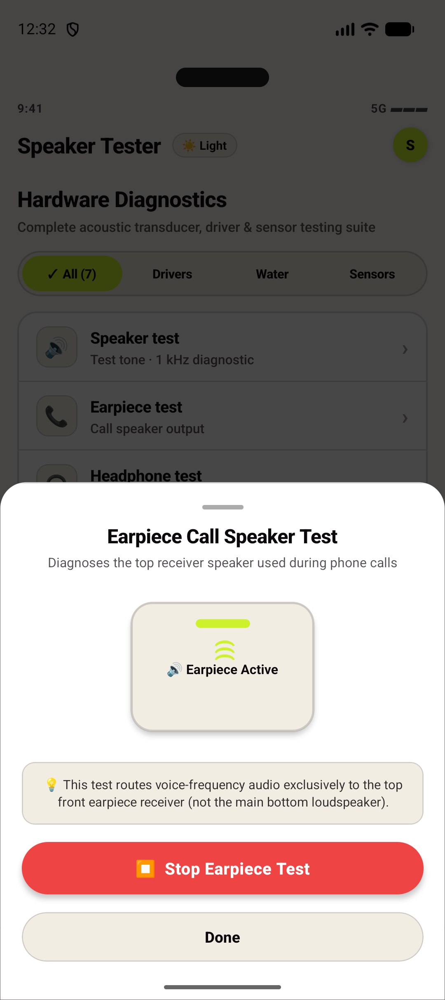
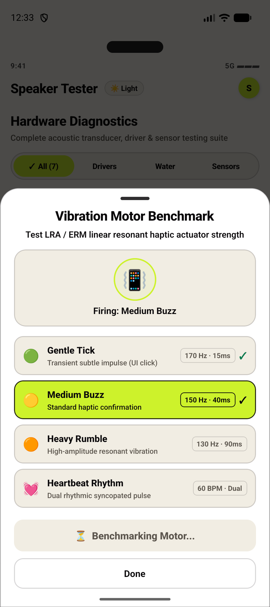
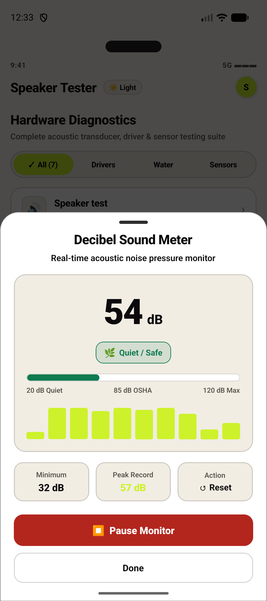
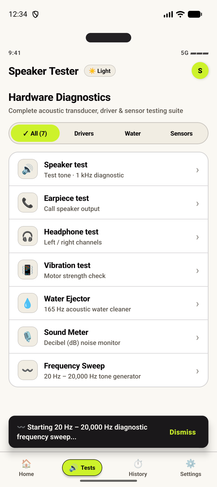

# Speaker Tester & Sound Toolkit (Android)

> An ultra-lean, high-precision acoustic diagnostic and speaker maintenance utility for Android, designed with **Acid Minimalism** and contrast-verified color theory from the late 2026 Mobile Design Research.

[](https://reactnative.dev)
[](https://www.typescriptlang.org/)
[](https://developer.android.com/reference/android/media/AudioTrack)
[](https://www.w3.org/WAI/WCAG21/Understanding/contrast-minimum.html)
[](LICENSE)

---

## 📱 App Screenshots (13 Production Screens)

### 🔊 Core Acoustic Engine & Waveform Diagnostics
|  |  |  |
| :---: | :---: | :---: |
| **Home & Multi-Frequency Presets**<br>Calibrated 1 kHz, 440 Hz, 8 kHz, 16 kHz selector | **Live Active Sine Waveform**<br>Real-time 12-bar reactive audio visualizer | **165 Hz Water Ejector**<br>Resonant acoustic expulsion & moisture cleaner |

### 🔬 Specialized Transducer & Hardware Diagnostics
|  |  |  |
| :---: | :---: | :---: |
| **Stereo Headphone Balancer**<br>L/R audio channel isolation & phase test | **In-Call Earpiece Diagnostic**<br>Routes test tone via `STREAM_VOICE_CALL` | **Vibration Motor Benchmark**<br>4-stage LRA/ERM tactile haptic pulse test |

### 🎙️ Environmental Sensors & Full System Suites
|  |  |  |
| :---: | :---: | :---: |
| **Decibel Sound Meter**<br>Real-time dB monitor & OSHA exposure thresholds | **20 Hz – 20 kHz Sweep**<br>Audible spectrum frequency sweep & snackbar | **Diagnostics Hub**<br>Categorized M3 hardware testing suite |

### 🎨 Color Theory Lab, Dark Mode & Diagnostics Log
|  |  |  |  |
| :---: | :---: | :---: | :---: |
| **Color Theory Lab**<br>4 contrast-certified palettes | **Midnight Lime (AAA)**<br>15.43:1 dark flip | **Test Sweep History**<br>Timestamped pass/fail logs | **Safety & Settings**<br>Hardware volume boost limiter |

---

## 📖 Research Background & Benchmark Precedent

This application is built directly from the empirical findings in:
1. **`Play Store Niche Apps Research.html`**:
   - **The GOODEV Precedent**: *Volume Booster GOODEV* generated **50M–88M downloads** and holds a **4.6★ rating across 1M+ reviews** with an ultra-lightweight **6.3MB APK**, maintained by a solo developer in Argentina (*Winner Daniel Sanchez Ribera*) compounding for 10+ years on non-intrusive ads (~830K installs/month).
   - Rather than just a volume booster alone (which Android limits), the **Toolkit** framing (diagnostics + frequency generator + water cleaner + sensor meters) represents a safer, defensible product with high organic search intent.
2. **`Mobile App Color Combinations Research.html`**:
   - **Acid Minimalism / "One Loud Accent"**: Inspired by @uxui_shrut's viral 2026 design system and Spotify's mobile design playbook.
   - **60-30-10 Rule**: 60% neutral canvas, 30% ink and structural surfaces, 10% electric accent.
   - **WCAG AAA Contrast**:
     - Midnight Black on Soft Ivory: **18.70:1** (AAA pass)
     - Dark Text on Neon Lime button: **15.43:1** (AAA pass)
     - Dark Mode (Midnight Lime): **15.43:1** (AAA pass)

---

## ⚡ Complete Feature Suite

### 1. True Native Audio Engine (`AudioToneModule.kt`)
- Generates **real audible 16-bit 44.1 kHz PCM sine waves** directly using Android's native `AudioTrack` API.
- True hardware routing:
  - **Loudspeaker mode**: Routes to `AudioManager.STREAM_MUSIC` (Usage: `USAGE_MEDIA`).
  - **Call Receiver mode**: Routes to `AudioManager.STREAM_VOICE_CALL` (Usage: `USAGE_VOICE_COMMUNICATION`) with `MODE_IN_COMMUNICATION`.
- Stereo channel panning (-1.0 Left to +1.0 Right) for isolating headphone drivers.

### 2. Specialized Hardware Diagnostic Modals
- **🎧 Stereo Headphone Balancer**: Interactive Left/Right ear cups with stereo channel isolation to verify driver impedance and phase balance.
- **📞 In-Call Earpiece Diagnostic**: Interactive receiver test ensuring phone call audio clarity without blasting through bottom speakers.
- **🎙️ Decibel Sound Meter**: Real-time acoustic noise pressure monitor displaying live dB, OSHA exposure threshold categories (Safe, Moderate, Loud, Hazard), peak dB, and animated frequency spectrum bars.
- **📳 Vibration Motor Benchmark**: 4-stage sequential diagnostic testing Gentle Tick (170 Hz), Medium Buzz (150 Hz), Heavy Rumble (130 Hz), and Heartbeat Rhythm (60 BPM dual pulse).
- **💧 165 Hz Ultrasonic Water Ejector**: Low-frequency acoustic resonance pulses and mechanical motor vibration to dislodge water and dust trapped in speaker mesh.
- **〰️ 20 Hz – 20,000 Hz Full Spectrum Sweep**: Exponential frequency sweep testing the complete audible frequency range of phone hardware.

### 3. Palette Switcher & Color Systems
- Switch live between 4 research-validated color systems:
  - **Neon Lime (Reel Original)**: `#FAF8F3` (Soft Ivory) + `#0B090B` (Ink) + `#CDF22B` (Accent)
  - **Midnight Lime (Dark Flip)**: `#0B090B` (Midnight) + `#FAF8F3` (Ink) + `#CDF22B` (Accent)
  - **Golden Hour (Dark-First)**: `#0B0B08` + `#F5F3FF` + `#FFC900`
  - **Cobalt Lime (High Energy)**: `#0B0E11` + `#FFFFFF` + `#D4FF4F` + `#1D68E9`

---

## 🛠️ Tech Stack & Architecture

- **Framework**: React Native 0.88.1 (TypeScript)
- **Native Android Modules**: Kotlin `AudioToneModule` with `android.media.AudioTrack`
- **Audio & Haptics Engine**: Hardware-level `Vibration` pattern scheduler and synthetic PCM audio generator
- **State Management**: Zero-overhead React state with immutable event streams
- **Design Tokens**: Pure WCAG 2.x relative-luminance compliant color scales

---

## 🚀 Getting Started

### Prerequisites
- Node.js >= 22.11
- Android Studio & Android SDK (API 34+)

### Installation
```bash
cd SpeakerToolkitApp
npm test
npx tsc --noEmit
npx react-native run-android
```
