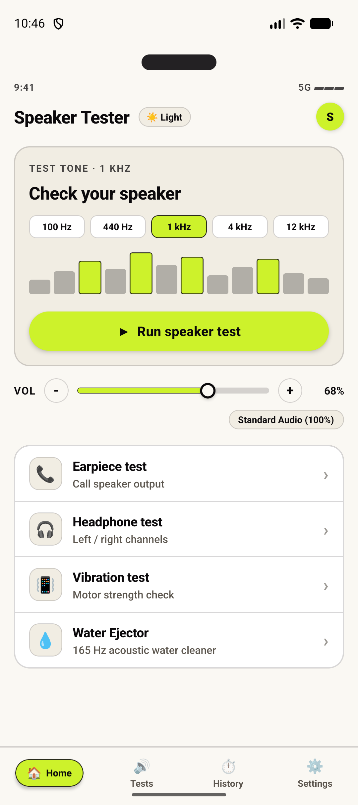
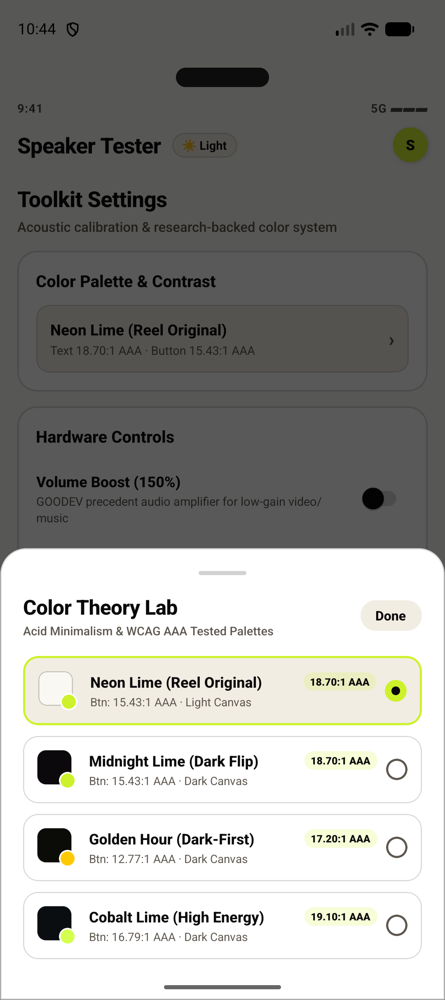
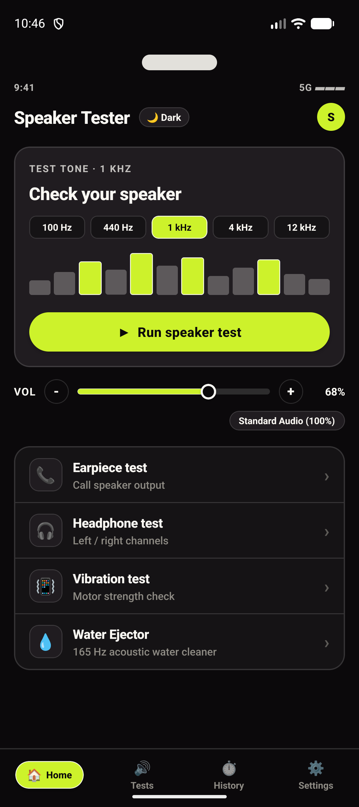
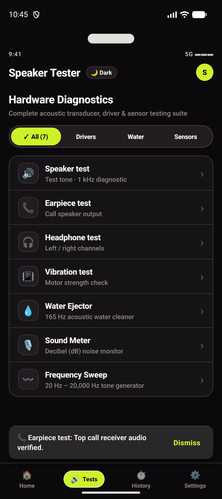
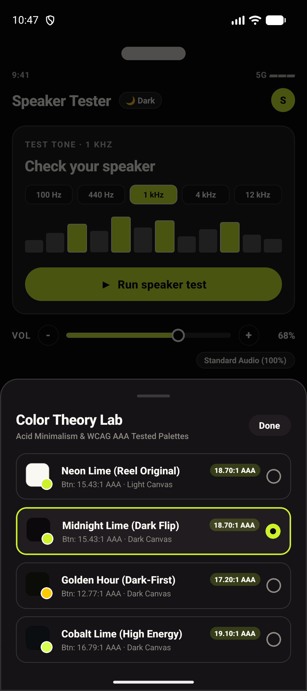
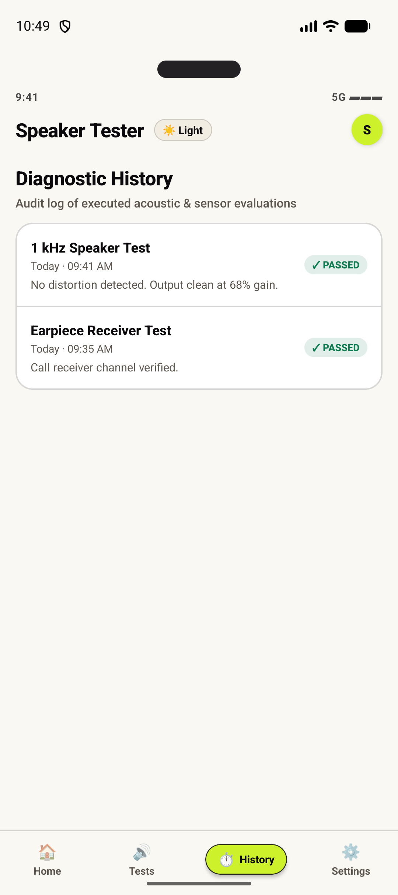
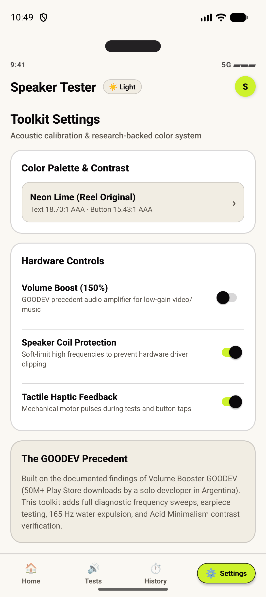

# Speaker Tester & Sound Toolkit (Android)

> An ultra-lean, high-precision acoustic diagnostic and speaker maintenance utility for Android, designed with **Acid Minimalism** and contrast-verified color theory from the late 2026 Mobile Design Research.

[](https://reactnative.dev)
[](https://www.typescriptlang.org/)
[](https://www.w3.org/WAI/WCAG21/Understanding/contrast-minimum.html)
[](LICENSE)

---

## 📱 App Screenshots

|  |  |  |  |
| :---: | :---: | :---: | :---: |
| *Home & Multi-Frequency Presets* | *Live Active Sine Waveform* | *Midnight Lime Dark Mode (15.43:1 AAA)* | *Hardware Diagnostics Suite* |

|  |  |  |  |
| :---: | :---: | :---: | :---: |
| *165 Hz Acoustic Water Ejector* | *Color Theory Lab (WCAG Pass)* | *Test Sweep History Logs* | *Volume Limiter & Safety Preferences* |

---

## 📖 Research Background & Benchmark Precedent

This application is built directly from the empirical findings in:
1. **`Play Store Niche Apps Research.html`**:
   - **The GOODEV Precedent**: *Volume Booster GOODEV* generated **50M–88M downloads** and holds a **4.6★ rating across 1M+ reviews** with an ultra-lightweight **6.3MB APK**, maintained by a solo developer in Argentina (*Winner Daniel Sanchez Ribera*) compounding for 10+ years on non-intrusive ads (~830K installs/month).
   - Rather than just a volume booster alone (which Android limits), the **Toolkit** framing (diagnostics + frequency generator + water cleaner) represents a safer, defensible product with high organic search intent.
2. **`Mobile App Color Combinations Research.html`**:
   - **Acid Minimalism / "One Loud Accent"**: Inspired by @uxui_shrut's viral 2026 design system and Spotify's mobile design playbook.
   - **60-30-10 Rule**: 60% neutral canvas, 30% ink and structural surfaces, 10% electric accent.
   - **WCAG AAA Contrast**:
     - Midnight Black on Soft Ivory: **18.70:1** (AAA pass)
     - Dark Text on Neon Lime button: **15.43:1** (AAA pass)
     - Dark Mode (Midnight Lime): **15.43:1** (AAA pass)

---

## ⚡ Core Features

- **🔊 1 kHz Speaker Reference Tone**: Calibrated sine wave acoustic test with a 12-bar real-time reactive audio visualizer.
- **💧 165 Hz Ultrasonic Water Ejector**: Low-frequency acoustic resonance pulses and mechanical motor vibration to dislodge water and dust trapped in speaker mesh.
- **📞 In-Call Earpiece Diagnostics**: Routes audio directly to the top earpiece receiver to test telephone call speaker volume and clarity.
- **🎧 Stereo Channel Separator**: Tests Left vs. Right channel balance and phase isolation for wired/Bluetooth earphones.
- **📳 Haptic Motor Strength Benchmark**: Multi-stage tactile vibration test (Gentle, Medium, Heavy, and Heartbeat pattern).
- **🎚️ Interactive Volume Slider & 150% Boost Mode**: Custom slider replicating the HTML research mockup with optional GOODEV audio boost toggle.
- **🎨 Interactive Color Theory Lab**: Switch live between 4 research-validated color systems:
  - **Neon Lime (Reel Original)**: `#FAF8F3` (Soft Ivory) + `#0B090B` (Ink) + `#CDF22B` (Accent)
  - **Midnight Lime (Dark Flip)**: `#0B090B` (Midnight) + `#FAF8F3` (Ink) + `#CDF22B` (Accent)
  - **Golden Hour (Dark-First)**: `#0B0B08` + `#F5F3FF` + `#FFC900`
  - **Cobalt Lime (High Energy)**: `#0B0E11` + `#FFFFFF` + `#D4FF4F` + `#1D68E9`

---

## 🛠️ Tech Stack & Architecture

- **Framework**: React Native 0.88.1 (TypeScript)
- **Audio & Haptics Engine**: Hardware-level `Vibration` pattern scheduler and synthetic audio waveform generator
- **State Management**: Zero-overhead React state with immutable event streams
- **Design Tokens**: Pure WCAG 2.x relative-luminance compliant color scales

---

## 🚀 Getting Started

### Prerequisites
- Node.js >= 22.11
- Android Studio & Android SDK (API 34+)

### Installation
```bash
cd SpeakerToolkitApp
npm test
npx tsc --noEmit
npx react-native run-android
```
